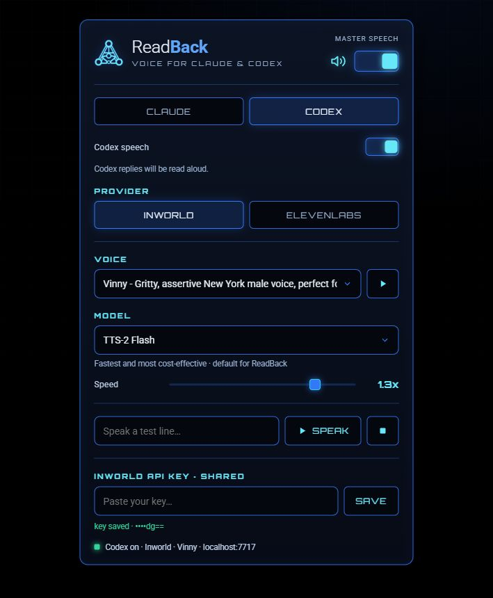

# ReadBack

**Voice for Claude and Codex.** Flip it on and your assistant reads its replies aloud,
so you can rest your eyes or keep half an ear on a long run instead of watching
the terminal scroll. Flip it off and it stops immediately, mid-sentence if the
phone rings.

Works with Claude Code (including inside Claude Desktop) and local Codex
desktop/CLI chats on Windows. Each assistant has its own saved voice settings.

<p align="center">
  
</p>

- **Windows only.** Plays through Windows' built-in audio (PowerShell's
  SoundPlayer), so there is no ffmpeg, mpv or VLC to install.
- **Two providers.** [Inworld](https://inworld.ai) and
  [ElevenLabs](https://elevenlabs.io), switchable in a click. The voice picker
  lists up to 200 of Inworld's English voices, or the voices on your ElevenLabs
  account. Both bill per character spoken.
- **GUI-tunable.** A little control panel for voice, model, speed and
  delivery, with separate Claude/Codex tabs, a live voice picker and in-app key entry. No `.env` fiddling.
- **Streaming.** Splits replies into sentences and starts talking on the first
  one, so audio kicks in fast even on long messages.
- **Multi-session.** Running Claude and Codex across several projects? Their replies
  **queue and read in order** instead of cutting each other off. Voice off still
  silences everything instantly.
- **Ducking (optional).** Music and other apps dip while ReadBack speaks or
  while you dictate, then come back. Off until you switch it on.

> Unofficial community tool. Not affiliated with, or endorsed by, Anthropic, OpenAI,
> Inworld, or ElevenLabs.

**Upgrading from 0.5.x?** 0.7.0 adds Codex support, separate Claude and Codex
voice profiles, Inworld TTS-2 and optional music ducking. Your voices, speeds
and keys carry over, and so does the master switch from 0.5.2 (coming from
0.5.0 or 0.5.1, your settings move to a new folder and voice starts off; see the
upgrade note under "Using it"). A saved Inworld TTS-1 or TTS-1.5 model moves to
TTS-2 Flash. See the [changelog](CHANGELOG.md). After `git pull`, run
`npm install`, then restart the panel and any open Claude or Codex sessions so
their ReadBack MCP server reloads.

---

## How it works

A few cooperating processes share the saved settings and one speech queue on
disk:

| Piece | Role |
|------|------|
| **Stop hooks** | The voice. When a reply finishes, Claude Code runs `hook/stop-hook.js` and Codex runs `hook/codex-stop-hook.js`. Each checks the speech switches, starts a background worker (`hook/worker.js` or `hook/codex-worker.js`) and exits at once, so the turn never waits on speech. The worker takes the reply (Claude's from the session transcript, Codex's from the Stop event), cleans it, synthesizes it a few sentences at a time starting with the first, and plays it in queue order. |
| **MCP server** | In-chat controls, 11 tools: `voice_on`, `voice_off`, `set_agent_enabled`, `voice_status`, `stop`, `say`, `set_provider`, `set_voice`, `set_model`, `set_speed` and `list_voices`. |
| **Control panel** | A local page at `127.0.0.1:7717` for provider, voice, model, tuning, keys, live preview and ducking. |
| **Ducking helper** | Started by the panel when ducking needs it: a detached Node relay (`scripts/audio-helper-relay.js`) runs a hidden PowerShell script (`scripts/audio-helper.ps1`) that compiles a small C# Core Audio helper and sets per-app volume on the panel's instructions. |

The hooks and the MCP controls work whether or not the panel is open. Ducking
needs the panel.

## Setup (Windows, Node 20+)

```powershell
git clone https://github.com/Deltawerks/readback
cd readback
npm install
npm run panel        # opens the control panel in your browser
```

In the panel: pick a **provider**, paste that provider's **API key**, choose a
**voice**, enable master speech and that agent, and hit ▶ to hear it. Then connect Claude Code, Codex, or both.

### Claude Code setup

```powershell
npm run register     # writes .mcp.json + hooks-snippet.json for this folder
```

**1. MCP server** (the in-chat toggle). When you work in this folder, Claude
Code finds the server in `.mcp.json` and asks you to approve it before it starts
it. To get it in *every* project, run the `claude mcp add` line that
`register` prints. That line uses **user scope** (`-s user`), which registers the
server once for your whole account. It matters: `claude mcp add` defaults to
local scope, which is only the project folder you ran it in, so without `-s user`
you get the toggle tools in one folder while the hook goes on speaking in every
other project.

**2. Auto-speak hook** (the part that actually talks). Open your Claude Code
settings at `C:\Users\<you>\.claude\settings.json`. What you do next depends on
what is already in that file.

*No settings file yet:* paste in the whole `hooks-snippet.json` that `register`
just wrote, as the entire file.

*A settings file with no `hooks` key:* add the snippet's `"hooks"` block as one
more top-level key, next to your existing settings.

*A settings file that already has a `hooks` key:* keep that key and put the
snippet's `"Stop"` entry **inside** it, alongside the hooks you already have:

```json
{
  "yourExistingSettings": "stay exactly as they are",
  "hooks": {
    "PreToolUse": [
      { "matcher": "Bash", "hooks": [ { "type": "command", "command": "node", "args": ["C:\\your\\existing\\hook.js"] } ] }
    ],
    "Stop": [
      { "hooks": [ { "type": "command", "command": "node", "args": ["C:\\path\\to\\readback\\hook\\stop-hook.js"], "timeout": 15 } ] }
    ]
  }
}
```

> **Never paste a second `"hooks"` key.** An object with the same key twice is
> still valid JSON, and the parser keeps the last one, so every hook you had
> before is dropped, silently, with no error anywhere.

If you already have a `"Stop"` array of your own, the same rule applies one level
down: add ReadBack's `{ "hooks": [ ... ] }` entry to that existing array instead
of adding a second `"Stop"` key.

Use the path from *your* generated snippet, not the one above. Then **restart
Claude Code**, say "voice on", and the next reply should speak.

### Codex setup (local Windows chats)

Use a current Codex desktop/CLI version with lifecycle hooks. ReadBack uses the
documented `Stop` event and its `last_assistant_message`, `session_id` and
`turn_id` fields for speech. It also reads session and turn metadata from the
chat transcript named in the event's `transcript_path`, to skip background turns
(see [Codex background turns](#codex-background-turns-and-playback-lifetime));
it does not read the screen. See [OpenAI's hook documentation](https://learn.chatgpt.com/docs/hooks).

```powershell
npm run register:codex
```

This creates **two snippets in this checkout only**. It does not install hooks,
enable speech, or change any saved settings:

1. **Auto-speak:** merge `codex-hooks-snippet.json` into
   `%USERPROFILE%\.codex\hooks.json` (or your custom `CODEX_HOME`). If the file
   does not exist, use the generated snippet as the whole file. If `hooks.Stop`
   already exists, append ReadBack's entry to that array. Preserve every other
   hook and keep a copy of the original file. Do not install ReadBack twice in
   user and project configuration.
2. **Optional in-chat controls:** merge `codex-mcp-snippet.toml` into
   `%USERPROFILE%\.codex\config.toml`. It defines `[mcp_servers.readback]`.
   If that table already exists, update that table rather than duplicating it.
   The panel can control speech without this MCP connection.
3. **Review and trust the new hook in Codex.** Untrusted hooks are skipped.
   If your desktop build does not expose hook review, use `/hooks` in a current
   Codex CLI using the same `CODEX_HOME`. Start a fresh local Codex chat afterward.
4. Turn voice on in the existing ReadBack panel. Finish a short Codex turn;
   its reply should join the same queue as Claude's replies.

The generated Windows command encodes a PowerShell invocation so paths with
spaces or special characters work. It runs Node and `hook/codex-stop-hook.js`
at the locations printed by `register:codex`. Regenerate the snippets if you
move the installation or Node.

**Two profiles, one master switch, one queue.** Claude and Codex each have a
saved provider, voice, model, tuning and speech switch. The tabs select which
profile you edit. Muting one agent stops its current and pending speech without
interrupting the other. Master speech off (or MCP voice_off) mutes both, including
previews; the Stop button cancels current and queued speech without changing
saved switches. API keys are shared per provider. Rebooting preserves all choices.

Codex's generated MCP snippet sets READBACK_SOURCE=codex. Claude defaults to its
own profile. MCP provider/voice/model/speed tools edit only their source profile;
set_agent_enabled changes its switch, while voice_on/off control the master.
Use the same `READBACK_STATE_DIR` and `READBACK_CACHE_DIR` overrides in every
process if you customize them.

**Scope:** local Windows execution only. Cloud chats and remote Linux/WSL hosts
are not supported by this playback adapter. Install only the main `Stop` hook,
not `SubagentStop`. Empty/non-text replies are skipped. Speech starts after the
stop event and the first audio chunk is synthesized; other replies may be ahead
of it in the queue. Another hook can continue a stopped turn, so it may still be
working while ReadBack reads that stop's reply.

**Disconnect or roll back:** remove only ReadBack's entry from Codex's `Stop`
array, and optionally its `[mcp_servers.readback]` table. Restart Codex. Claude
continues using its existing hook and saved settings. To return the application
code to the pre-Codex release without overwriting your checkout, make a separate
checkout of tag `v0.5.2` (for example `git worktree add ..\readback-0.5.2 v0.5.2`),
run `npm ci` there, and regenerate the Claude registration for that location.
Keep the current checkout until the old version is verified. Do not delete
`%USERPROFILE%\.readback`: both versions keep your saved voices and keys there.
Since 0.7.0, the next settings save adds agent profiles to `state.json`, and
0.5.2 cannot control separate profiles, so back up `state.json` before
downgrading.

If Codex is silent, check hook trust, both master and Codex switches, and `readback.log` in
the cache directory. Connecting the MCP server alone does not enable auto-speak.

**Optional:** `npm run shortcut` drops a "ReadBack" icon on your Desktop that
opens the panel in one click.

Quick smoke test, neither assistant required (it speaks only while master
speech and Claude speech are on):

```powershell
npm run say "ReadBack is online"
npm run voices        # list the voices of the Claude profile's provider
```

### Day to day (and after a reboot)

Once registered, Claude and Codex use ReadBack independently. Opening either
assistant loads its configured MCP controls; its Stop hook reads the saved
master and agent switches for each reply. Closing one assistant does not turn
off the other or reset your choices. No manual speech-service startup is needed.

The panel server runs independently of both assistants. The Desktop shortcut
starts it if needed and opens the settings page; opening the shortcut again
reuses the running server. Closing the browser tab only closes the view.
Automatic speech works even when the panel server is not running; ducking does
not.

Use the Desktop shortcut for normal use, or start the independent panel directly:

```powershell
powershell -NoProfile -ExecutionPolicy Bypass -File scripts/launch-panel.ps1
```

Add `-NoOpen` to start it without opening a browser. To launch the panel at Windows
sign-in, place a shortcut to `scripts/launch-panel.vbs` in your Startup folder
(open `shell:startup` from Windows Run). This is optional; it is not required for
automatic speech. The development command `npm run panel` stays attached to the
terminal that runs it.

### Codex background turns and playback lifetime

Codex fires `Stop` for more than the replies you asked for, so ReadBack checks
where each turn came from before speaking it. The event must be a main-thread
`Stop` with a session id, a turn id and reply text; one that names a subagent
(`agent_id`) is ignored. ReadBack then reads two records from the chat
transcript the event points to:

- **The session header**, the transcript's first line. It must carry the same
  session id and must not mark the session as a fork or a subagent: a
  `thread_source` other than `user`, or a structured `source`, means silence.
  Composer predictions (the gray suggested next message) run in ephemeral forks
  like this.
- **The turn's `task_started` record**, found by searching backward from the
  newest records, so a long chat's history has no total-size cutoff. A turn
  started by another agent (`initiating_agent_path`) stays silent, and so does a
  turn whose `turn_trigger` is present but is not `composer`, `cli` or `exec`. A
  turn whose record carries no attribution at all is spoken.

If the event names no transcript, the transcript cannot be read, or the turn is
not in it, the reply stays silent. Window focus plays no part. The spoken text
still comes from the Stop event's `last_assistant_message`; the transcript is
read only for these fields. Stop does not expose the turn trigger itself, so
the check depends on Codex's current transcript format, and a future Codex
release may need a compatibility update. Manual MCP speech is not affected.

On Windows, both the panel launcher and the Codex speech worker use WMI to start
outside the calling app's process job. This lets playback finish when Codex
completes its turn and cleans up the hook. A normal Node detached child still
belongs to that job and can be terminated with it.

Reply text travels in a single-use file in the user's ReadBack cache, which the
worker removes after reading. Environment variables reach the worker through the
launcher's standard input, never in command-line arguments or the reply file.
Stop, master mute, and per-agent mute continue to use the shared queue and
player controls.

## Using it

- In chat: say "voice on" and replies start speaking. "voice off" silences
  instantly, including whatever's playing right then.
- Multiple projects or assistants at once: their replies line up and read one after another
  instead of stomping each other. "voice off" (or the panel's Stop button) clears
  the whole queue at once, for when the phone rings.
- In the panel: switch provider, pick a voice, adjust speed / delivery, hit ▶ to
  preview. The panel's Speak/preview takes over immediately (it's you, at the
  keyboard); only the automatic per-reply speech queues.
- Voice off means off. Both the MCP `say` tool and panel previews respect the
  master and selected agent switches. Enable both switches to hear a test.

Keys are stored per user, in plain text, **outside the repo**:
`%USERPROFILE%\.readback\secret.json` on Windows (`~/.config/readback/`
elsewhere), so cloning into a shared or cloud-synced folder can't sync your key
with it. Override the location with `READBACK_STATE_DIR`. A key set as an
environment variable takes precedence over the one saved in the panel, and the
saved one over `.env`.

Working files (the log, the queue, the list of running players, the WAV chunks,
the ducking recovery list) live separately in `%USERPROFILE%\.readback\cache`
(`~/.cache/readback` elsewhere). Override that with `READBACK_CACHE_DIR`.

> **If you override either path, set it for every ReadBack process, not just
> one.** The panel, the MCP server and each hook worker resolve these
> independently from the environment they were launched in. When they disagree,
> the toggle appears to work and controls nothing, because the half that speaks
> is reading different files than the half you clicked. `npm run where` prints
> the resolved paths; run it from the panel's environment and from each connected assistant
> session and compare. The panel also reports both at `/health`.

Replies are cleaned before speaking (code blocks dropped, links flattened,
markdown/emoji stripped). A reply longer than 12,000 characters is cut short
with a spoken "the rest is on screen"; the cap is a backstop, high enough not to
clip normal replies. To change it, set `READBACK_MAX_CHARS` to a positive whole
number. It is applied each time a reply is read, so put it in `.env`, which
every ReadBack process loads, or in the environment of every process. There is
no panel control for it, and a blank or invalid value is ignored.

> **Upgrading from 0.5.1 or earlier?** On first run ReadBack copies your key and
> settings from the old location (`%APPDATA%\Readback`, or a `.readback` or
> `.voicebox` folder inside the checkout) to `%USERPROFILE%\.readback`, and
> starts with voice off. The originals are left where they were, so nothing is
> lost if you roll back; delete them once you've confirmed things still work.
> Nothing is copied when `READBACK_STATE_DIR` is set.

## Ducking (Windows)

Switch on **Ducking** in the panel and ReadBack gets out of your way:

- **While ReadBack speaks**, other apps that are playing (music, videos, games)
  dip to 10% of their level and come back when the voice is done.
- **While you dictate** into Claude Desktop or Codex Desktop, the same dip
  happens. If ReadBack starts talking while your mic is open, it whispers at 15%
  instead of blasting into your voice-to-text.

There is nothing to set up per player. Ducking works with apps that play
through the normal Windows mixer, the ones the Volume Mixer lists; an app that
takes the device in WASAPI exclusive mode bypasses the mixer and is not lowered.
ReadBack watches which apps have your microphone open. Windows reports this per
app: `claude` is Claude Desktop and `ChatGPT` is Codex Desktop. If a dictation
app keeps the microphone open after you stop talking, other audio stays lowered
until it closes it. ReadBack lowers other apps through Windows' own per-app
volume, the same levels as the Volume Mixer. Move an app's volume yourself
during a dip and ReadBack leaves it alone.

Ducking runs inside the panel server, so keep the panel running (see "Day to
day" for starting it at sign-in). Levels go back like this:

- **The panel server exits or dies.** The audio helper sees the panel go away,
  puts back what it lowered, and exits.
- **The panel and the helper both die mid-dip** (a crash, a power cut). The
  lowered apps and their original levels are on record in the cache folder. On
  its next start the panel runs the helper for up to 30 seconds, even with
  ducking switched off, and puts back each app on that list that is open and
  still lowered. An app whose volume you have set since is left alone. Apps that
  are not open by then stay on the list, for up to a week, until a later panel
  start finds them, or until they open again while ducking is on. Switching
  ducking off and pressing **Restore volume** start the same 30-second run
  whenever apps remain to be put back.
- **Restore volume** in the panel puts everything back on demand.

The settings cover the dip depth for other audio and for ReadBack, which apps count as dictation, and a "never lower" list (for a call app, say). Ducking is off on a fresh install. Windows only for now.

With ducking on, ReadBack sets its own playback level on every reply: full, or the whisper level while you dictate. A lower level you give "Windows PowerShell" in the Volume Mixer (which is ReadBack's voice) won't stick while ducking is on, so set ReadBack's loudness with your system volume instead.

## Security and privacy

- **The panel is loopback-only.** It listens on `127.0.0.1` and nowhere else.
  Every request must carry a loopback `Host` header, which defeats DNS
  rebinding; API requests from other websites are refused, which defeats
  cross-site request forgery; and the page cannot be framed. It bundles its own
  logo and fonts, so the page itself loads nothing from the internet. Like any
  local server, it trusts programs already running on your computer.
- **`READBACK_ALLOWED_ORIGINS`** is empty by default. It takes a comma-separated
  list of web origins, such as a dashboard page you run, that may use one route,
  `/api/state`, from a browser on this machine: to read the saved settings
  (switches, provider, voice and tuning choices, ducking settings, but never the
  keys or key hints) and to switch master speech on or off. Nothing else: such a
  page cannot change the provider, voice, model, tuning, keys or ducking
  settings, list voices, or make ReadBack speak. The panel still listens only on
  `127.0.0.1`. Only list origins you control.
- **Keys are stored in plain text** in `secret.json` under your user profile
  (`%USERPROFILE%\.readback\secret.json`), so any program running under your
  account can read them. The panel shows only their last four characters.
- **What leaves your machine:** synthesis and the voice list call out, by
  design. Your cleaned, truncated reply text and your API key go to whichever
  provider you picked (Inworld or ElevenLabs) over HTTPS, and nowhere else.
  ReadBack has no servers, no telemetry, no analytics, and no update check.
- **MCP tools and untrusted content.** If your assistant reads untrusted content
  (web pages, issues, files from strangers), don't auto-approve ReadBack's
  `say`, `voice_on` and `set_*` tools: instructions planted in that content
  could make the assistant call them. `say` spends TTS credit directly,
  `voice_on` turns speech (and so spending) back on, and the `set_*` tools
  change your settings.

### Why it looks like that

ReadBack does a few things that are unusual for a small Node tool. Each has a
reason and all of the code is in this repository, but antivirus or EDR software
may flag them:

- **WMI process launches.** The Codex speech worker and the panel launcher start
  through WMI (`Win32_Process.Create`), so they run outside the job object of
  the app that started them and survive Codex's end-of-turn cleanup or the
  launching app closing.
- **Hidden PowerShell with `-ExecutionPolicy Bypass`.** Playback runs
  `scripts/play-stream.ps1` in a hidden PowerShell process, and stopping
  playback runs a PowerShell command that finds ReadBack's own player processes
  by command line and ends them. The panel launcher, the ducking helper and the
  `register` and `shortcut` npm scripts also run PowerShell with Bypass, which
  lets the bundled scripts run without changing your execution policy. The
  generated Codex hook command is a PowerShell `-EncodedCommand`, which keeps
  paths with spaces and quotes intact; it decodes to a call of Node with
  `hook\codex-stop-hook.js`.
- **A helper compiled at run time.** For ducking, `scripts/audio-helper.ps1`
  compiles a small C# Core Audio helper with `Add-Type`. It changes other apps'
  per-app volume and checks which apps have the microphone open; it never opens
  the microphone or reads any audio.

## Notes & limits

- Windows only (PowerShell `SoundPlayer` playback). On other systems the hooks
  do not synthesize anything, so automatic speech bills nothing. No STT / voice
  input.
- Speech is provider-agnostic WAV under the hood (Inworld LINEAR16; ElevenLabs
  PCM wrapped in a WAV header), so the streaming player never cares which
  provider you're on.
- **It costs money per character spoken.** Both providers bill per character;
  see [Inworld's pricing](https://inworld.ai/pricing) and
  [ElevenLabs' API pricing](https://elevenlabs.io/pricing/api) for current
  rates. Previews, the panel's Speak button and the MCP `say` tool are billed
  the same way. Inworld defaults to TTS-2 Flash (`inworld-tts-2-flash`), the
  lower-priced of its two TTS-2 models; TTS-2 flagship (`inworld-tts-2`) adds
  Stable, Balanced and Creative delivery modes. Flash exposes speed only;
  neither sends the obsolete temperature setting. ElevenLabs remains available
  with its own voice and tuning controls. Check your provider's current plan
  before enabling speech across every project. `READBACK_MAX_CHARS` limits the
  length of each spoken reply (12,000 characters by default).
- Trouble? Check `readback.log` in the cache folder
  (`%USERPROFILE%\.readback\cache` on Windows); `npm run where` prints its exact
  path.

## Tests

`npm test` runs the test suite. No test calls Inworld or ElevenLabs, and none
changes real audio levels. `npm run test:audio` runs the Windows audio
integration tests: they play a silent test tone and briefly change that test
app's per-app volume, never another app's. If ReadBack's own ducking is
switched on, switch it off before running them.

## Contributors

ReadBack is a DeltaWerks project built with contributions from multiple AI coding assistants:

- **DeltaWerks** - project creator, product direction, design, and real-world testing.
- **Claude (Anthropic)** - the original Claude integration, earlier speech, queue, and settings-reliability work, and voice-aware ducking in 0.7.
- **Codex (OpenAI)** - Codex integration, independent Claude/Codex profiles, Inworld TTS-2 controls, Windows playback-lifetime fixes, regression tests, and documentation for the 0.6 work that shipped in 0.7.0.

## License

MIT. See [LICENSE](LICENSE).
