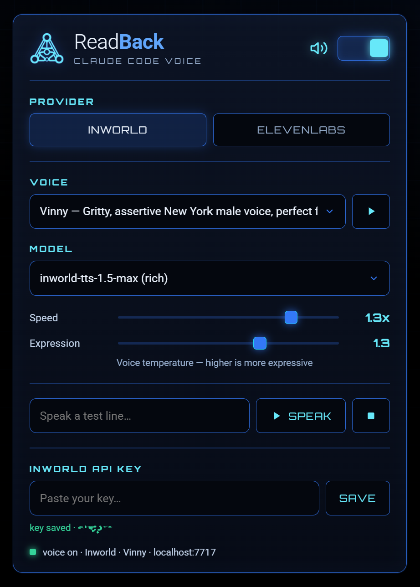

# Readback

**Voice for Claude Code and Codex.** Flip it on and your assistant reads its replies aloud,
so you can rest your eyes or keep half an ear on a long run instead of watching
the terminal scroll. Flip it off and it stops immediately, mid-sentence if the
phone rings.

<p align="center">
  
</p>

- 🪟 **Windows-first.** Plays through built-in PowerShell audio, with zero
  external dependencies. (Most Claude voice tools are macOS-only.)
- 🎚️ **Two providers.** [Inworld](https://inworld.ai) (hundreds of voices, cheap)
  and [ElevenLabs](https://elevenlabs.io), switchable in a click.
- 🖥️ **GUI-tunable.** A little control panel for voice, model, speed and
  delivery, with separate Claude/Codex tabs, a live voice picker and in-app key entry. No `.env` fiddling.
- ⚡ **Streaming.** Splits replies into sentences and starts talking on the first
  one, so audio kicks in fast even on long messages.
- 🔀 **Multi-session.** Running Claude and Codex across several projects? Their replies
  **queue and read in order** instead of cutting each other off. Voice off still
  silences everything instantly.

> Unofficial community tool. Not affiliated with, or endorsed by, Anthropic, OpenAI,
> Inworld, or ElevenLabs.

**Already using it?** 0.6.0 adds Codex and independent agent profiles. Existing
voices and speeds seed both profiles; deprecated Inworld models move to TTS-2
Flash. The saved master mute and provider keys are preserved. See
the [changelog](CHANGELOG.md) and the Codex setup below.

---

## How it works

Three cooperating pieces sharing one state file:

| Piece | Role |
|------|------|
| **MCP server** | in-chat toggle: `voice_on` / `voice_off` / `set_provider` / `set_voice` / `say` / `list_voices` |
| **Stop hook** | the actual voice: auto-speaks each reply while enabled |
| **Control panel** | `localhost:7717` web cockpit for provider / voice / model / tuning + live preview |

The hook and MCP toggle work whether or not the panel is open.

## Setup (Windows, Node 18+)

```powershell
git clone https://github.com/Deltawerks/readback
cd readback
npm install
npm run panel        # opens the control panel in your browser
```

In the panel: pick a **provider**, paste that provider's **API key**, choose a
**voice**, enable master speech and that agent, and hit ▶ to hear it. Then connect Claude Code, Codex, or both.

### Claude Code setup

```powershell
npm run register     # writes .mcp.json + hooks-snippet.json for this folder
```

**1. MCP server** (the in-chat toggle). Auto-loads whenever you work in this
folder. To get it in *every* project, run the `claude mcp add` line that
`register` prints. That line uses **user scope** (`-s user`), which registers the
server once for your whole account. It matters: `claude mcp add` defaults to
local scope, which is only the project folder you ran it in, so without `-s user`
you get the toggle tools in one folder while the hook goes on speaking in every
other project.

**2. Auto-speak hook** (the part that actually talks). Open your Claude Code
settings at `C:\Users\<you>\.claude\settings.json`. What you do next depends on
what is already in that file.

*No settings file yet:* paste in the whole `hooks-snippet.json` that `register`
just wrote, as the entire file.

*A settings file with no `hooks` key:* add the snippet's `"hooks"` block as one
more top-level key, next to your existing settings.

*A settings file that already has a `hooks` key:* keep that key and put the
snippet's `"Stop"` entry **inside** it, alongside the hooks you already have:

```json
{
  "yourExistingSettings": "stay exactly as they are",
  "hooks": {
    "PreToolUse": [
      { "matcher": "Bash", "hooks": [ { "type": "command", "command": "node", "args": ["C:\\your\\existing\\hook.js"] } ] }
    ],
    "Stop": [
      { "hooks": [ { "type": "command", "command": "node", "args": ["C:\\path\\to\\readback\\hook\\stop-hook.js"], "timeout": 15 } ] }
    ]
  }
}
```

> **Never paste a second `"hooks"` key.** An object with the same key twice is
> still valid JSON, and the parser keeps the last one, so every hook you had
> before is dropped, silently, with no error anywhere.

If you already have a `"Stop"` array of your own, the same rule applies one level
down: add Readback's `{ "hooks": [ ... ] }` entry to that existing array instead
of adding a second `"Stop"` key.

Use the path from *your* generated snippet, not the one above. Then **restart
Claude Code**, say "voice on", and the next reply should speak.

### Codex setup (local Windows chats)

Use a current Codex desktop/CLI version with lifecycle hooks. ReadBack uses the
documented `Stop` event and its `last_assistant_message`, `session_id` and
`turn_id` fields. It does not scrape the screen or read Codex's private transcript
format. See [OpenAI's hook documentation](https://learn.chatgpt.com/docs/hooks).

```powershell
npm run register:codex
```

This creates **two snippets in this checkout only**. It does not install hooks,
enable speech, or change any saved settings:

1. **Auto-speak:** merge `codex-hooks-snippet.json` into
   `%USERPROFILE%\.codex\hooks.json` (or your custom `CODEX_HOME`). If the file
   does not exist, use the generated snippet as the whole file. If `hooks.Stop`
   already exists, append ReadBack's entry to that array. Preserve every other
   hook and keep a copy of the original file. Do not install ReadBack twice in
   user and project configuration.
2. **Optional in-chat controls:** merge `codex-mcp-snippet.toml` into
   `%USERPROFILE%\.codex\config.toml`. It defines `[mcp_servers.readback]`.
   If that table already exists, update that table rather than duplicating it.
   The panel can control speech without this MCP connection.
3. **Review and trust the new hook in Codex.** Untrusted hooks are skipped.
   If your desktop build does not expose hook review, use `/hooks` in a current
   Codex CLI using the same `CODEX_HOME`. Start a fresh local Codex chat afterward.
4. Turn voice on in the existing ReadBack panel. Finish a short Codex turn;
   its reply should join the same queue as Claude's replies.

The generated Windows command encodes a PowerShell invocation so paths with
spaces or special characters work. It runs Node and `hook/codex-stop-hook.js`
at the locations printed by `register:codex`. Regenerate the snippets if you
move the installation or Node.

**Two profiles, one master switch, one queue.** Claude and Codex each have a
saved provider, voice, model, tuning and speech switch. The tabs select which
profile you edit. Muting one agent stops its current and pending speech without
interrupting the other. Master speech off (or MCP voice_off) mutes both, including
previews; the Stop button cancels current and queued speech without changing
saved switches. API keys are shared per provider. Rebooting preserves all choices.

Codex's generated MCP snippet sets READBACK_SOURCE=codex. Claude defaults to its
own profile. MCP provider/voice/model/speed tools edit only their source profile;
set_agent_enabled changes its switch, while voice_on/off control the master.
Use the same `READBACK_STATE_DIR` and `READBACK_CACHE_DIR` overrides in every
process if you customize them.

**Scope:** local Windows execution only. Cloud chats and remote Linux/WSL hosts
are not supported by this playback adapter. Install only the main `Stop` hook,
not `SubagentStop`. Empty/non-text replies are skipped. Speech starts after the
stop event and the first audio chunk is synthesized; other replies may be ahead
of it in the queue. Another hook can continue a stopped turn, so it may still be
working while ReadBack reads that stop's reply.

**Disconnect or roll back:** remove only ReadBack's entry from Codex's `Stop`
array, and optionally its `[mcp_servers.readback]` table. Restart Codex. Claude
continues using its existing hook and saved settings. To return the application
code to the pre-Codex release without overwriting your checkout, create a separate
checkout at commit `2ad8aeb80f0c3ba993d0da8b46cdf1eb6a17f649` (version 0.5.2), run
`npm ci`, and regenerate the Claude registration for that location. Keep the
current checkout until the old version is verified. Do not delete `.readback`:
it holds your saved voices and keys. Version 0.6.0 automatically adds agent
profiles on the next settings save. Back up state.json before downgrading: 0.5.2
cannot control separate profiles, and older Inworld models are deprecated.

If Codex is silent, check hook trust, both master and Codex switches, and `readback.log` in
the cache directory. Connecting the MCP server alone does not enable auto-speak.

**Optional:** `npm run shortcut` drops a "Readback" icon on your Desktop that
opens the panel in one click.

Quick smoke test, no Claude Code required:

```powershell
npm run say "readback is online"
npm run voices        # list the active provider's voices
```

### Day to day (and after a reboot)

**Nothing to restart.** Claude Code launches the MCP server itself, and the hook
is just a line in its settings file, so both come back on their own after a
reboot.

The control panel is **optional and on-demand**: a settings GUI, not a background
service. Voice keeps working whether or not it's open, because the hook reads
your saved settings from disk. Launch it (Desktop icon or `npm run panel`) when
you want to switch voice, provider or speed, then close it again.

## Using it

- In chat: say "voice on" and replies start speaking. "voice off" silences
  instantly, including whatever's playing right then.
- Multiple projects or assistants at once: their replies line up and read one after another
  instead of stomping each other. "voice off" (or the panel's Stop button) clears
  the whole queue at once, for when the phone rings.
- In the panel: switch provider, pick a voice, adjust speed / delivery, hit ▶ to
  preview. The panel's Speak/preview takes over immediately (it's you, at the
  keyboard); only the automatic per-reply speech queues.
- Voice off means off. Both the MCP `say` tool and panel previews respect the
  master and selected agent switches. Enable both switches to hear a test.

Keys are stored per-user **outside the repo**: `%USERPROFILE%\.readback\secret.json`
on Windows (`~/.config/readback/` elsewhere), so cloning into a shared or
cloud-synced folder can't sync your key with it. Override the location with
`READBACK_STATE_DIR`.

Working files (the log, the queue, the list of running players, the WAV chunks)
live separately in `%USERPROFILE%\.readback\cache` (`~/.cache/readback` elsewhere), so
they can't bloat a synced profile. Override that with `READBACK_CACHE_DIR`.

> **If you override either path, set it for every Readback process, not just
> one.** The panel, the MCP server and each hook worker resolve these
> independently from the environment they were launched in. When they disagree,
> the toggle appears to work and controls nothing, because the half that speaks
> is reading different files than the half you clicked. `npm run where` prints
> the resolved paths; run it from the panel's environment and from a Claude Code
> session and compare. The panel also reports both at `/health`.

Replies are cleaned before speaking (code blocks dropped,
links flattened, markdown/emoji stripped). Extremely long replies are capped
with a spoken "the rest is on screen", but the cap is deliberately high so it
acts as a backstop rather than clipping normal replies. Set
`READBACK_MAX_CHARS` if you want a shorter ceiling on how long a read can run.

> **Upgrading from an earlier version?** Your key and settings are copied to the
> new location automatically on first run. The originals are left in the repo's
> `.readback/` folder (gitignored), so nothing is lost if you roll back. Delete
> that folder once you've confirmed things still work.

## Notes & limits

- Windows only (PowerShell `SoundPlayer` playback). No STT / voice input.
- Speech is provider-agnostic WAV under the hood (Inworld LINEAR16; ElevenLabs
  PCM wrapped in a WAV header), so the streaming player never cares which
  provider you're on.
- The panel is loopback-only (`127.0.0.1`), rejects cross-origin requests, and
  bundles its own logo + fonts, so the page itself loads nothing from the
  internet.
- Synthesis *does* call out, by design: your cleaned, truncated reply text and
  your API key go to whichever provider you picked (Inworld or ElevenLabs) over
  HTTPS, and nowhere else. Readback has no servers, no telemetry, no analytics,
  and no update check.
- **It costs money per character spoken.** Inworld defaults to TTS-2 Flash
  (inworld-tts-2-flash), its most cost-efficient current model. TTS-2 flagship
  (inworld-tts-2) adds Stable, Balanced and Creative delivery modes. Flash exposes
  speed only; neither sends the obsolete temperature setting. ElevenLabs remains
  available with its own voice and tuning controls. Check your provider's current
  plan/pricing before enabling speech across every project. READBACK_MAX_CHARS
  limits the length of each spoken reply (12,000 characters by default).
- Trouble? Check `readback.log` in `%USERPROFILE%\.readback\cache` on Windows
  (throwaway data is kept out of the roaming profile), or alongside the state dir
  otherwise.

## License

MIT. See [LICENSE](LICENSE).
